# TrueSWE

Benchmark coding agents on reproducible tasks.
Compare project instructions and skills using verified outcomes and recorded runs.

<picture>
  <source media="(prefers-color-scheme: dark)" srcset=".github/assets/banner-dark.svg">
  <source media="(prefers-color-scheme: light)" srcset=".github/assets/banner-light.svg">
  
</picture>

## Get started

Requires Node 24.12 or later in the Node 24 series, clang, and macOS or Linux.

```sh
npm ci
npm run setup
npm start -- --help
```

See [local setup](docs/local-services.md) to run a benchmark with Langfuse.
Use `npm run check` to run the development checks.
